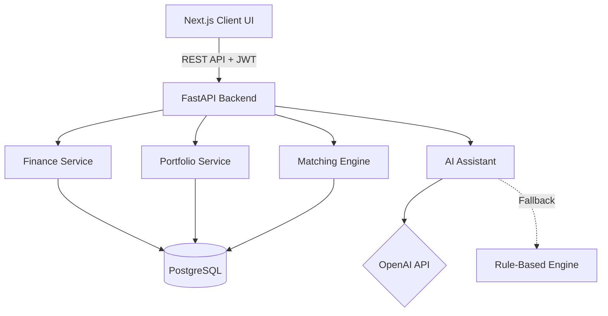

# FinTech Intelligence Platform: AI-Powered Personal Finance and Portfolio Risk Dashboard

[](https://github.com/yigitsarpavci/fintech-intelligence-platform/actions/workflows/backend-pytest.yml)
[](https://github.com/yigitsarpavci/fintech-intelligence-platform/actions/workflows/frontend-build.yml)
[](https://opensource.org/licenses/MIT)

An educational, full-stack financial technology application that integrates personal finance tracking, portfolio risk analysis, an AI-powered financial assistant, and a live trading simulator engine.

> **Disclaimer:** This project is built strictly for educational and portfolio demonstration purposes. None of the insights, risk profiles, or AI outputs constitute real financial or investment advice.

---

## Table of Contents
- [Problem Statement](#problem-statement)
- [Key Features](#key-features)
- [Tech Stack](#tech-stack)
- [Architecture and Diagrams](#architecture-and-diagrams)
- [Database Schema](#database-schema)
- [API Overview](#api-overview)
- [Local Setup Instructions](#local-setup-instructions)
- [Deployment Guide](#deployment-guide)
- [What I Learned](#what-i-learned)
- [Architectural Roadmap](#architectural-roadmap-and-recent-enhancements)

---

## Problem Statement

In modern fintech, data is often scattered across banking apps, brokerage accounts, and budgeting tools. Furthermore, sophisticated financial insights (like portfolio concentration risk and diversification scoring) are typically reserved for institutional traders.

**The FinTech Intelligence Platform** bridges this gap by offering a single, unified dashboard where users can track basic transactions, analyze complex portfolio metrics, receive actionable (educational) AI insights, and test trading strategies against an in-house limit order matching engine.

---


## Business Value & Target Audience

- **Target Audience:** Retail investors managing their own portfolios, and small brokerages seeking a white-label solution for client-facing risk analytics.
- **Value Proposition:** Brings institutional-grade portfolio risk analysis (diversification scoring) and a high-performance order matching engine to the retail market, consolidating scattered financial data into a single actionable dashboard.

## Monetization Strategy (SaaS Model)

- **Starter Tier (Free):** Basic portfolio tracking and manual simulated trading.
- **Pro Tier ($14.99/mo):** Unlimited access to the AI Financial Assistant and real-time portfolio optimization scoring.
- **Enterprise API:** B2B access to the Limit Order Matching Engine for institutional clients (volume-based pricing).

## Key Features

- **Personal Finance Dashboard:** Track income vs. expenses, analyze spending via category breakdown charts, and monitor a dynamic "Financial Health Score".
- **Portfolio Risk Analyzer:** A dynamic tool that evaluates asset allocation, largest holding concentration, and calculates a Diversification Score (0-100).
- **AI Financial Assistant:** Generates personalized, plain-English educational insights based on real user data (spending habits, risk profiles) via OpenAI's LLM (with a robust rule-based fallback).
- **Limit Order Trading Simulator:** A sophisticated Price-Time Priority order matching engine handling bids/asks, spread calculations, and partial fills.
- **Secure Authentication:** JWT-based stateless authentication with `bcrypt` password hashing.

---

## Tech Stack

### Frontend
- **Framework:** Next.js 14 (App Router), React 18
- **Styling:** Tailwind CSS (Glassmorphism aesthetics)
- **Data Visualization:** Recharts
- **Icons:** Lucide-React

### Backend
- **Framework:** FastAPI (Python)
- **Database:** PostgreSQL
- **ORM and Migrations:** SQLAlchemy, Alembic
- **AI Integration:** OpenAI API (`gpt-3.5-turbo`)

### DevOps and Testing
- **Containerization:** Docker and Docker Compose
- **Testing:** Pytest (100% backend unit test coverage for core engines)

---

## Architecture and Diagrams



---

## Database Schema

The relational database is carefully structured to avoid data anomalies and support advanced queries:
- `users`: Core identity (email, hashed_password).
- `transactions`: Tracks fiat movements (Income/Expense).
- `assets`: Global list of tradable entities (Crypto, Stocks, ETFs).
- `portfolio_holdings`: User's asset balances and average buy prices.
- `orders`: Limit orders submitted to the trading simulator.
- `trades`: Executed matches between buy and sell orders.
- `ai_insights`: Cached responses generated by the LLM or fallback engine.

---

## API Overview

The REST API is automatically documented via Swagger UI at `/docs`.

- **`POST /api/v1/auth/login`**: Authenticates user and returns JWT.
- **`GET /api/v1/finance/monthly-summary`**: Aggregates income/expenses.
- **`GET /api/v1/portfolio/risk-analysis`**: Calculates diversification and risk metrics.
- **`POST /api/v1/trading/orders`**: Submits an order to the matching engine.
- **`GET /api/v1/trading/order-book`**: Retrieves live bids, asks, and spread.
- **`POST /api/v1/ai/financial-summary`**: Requests an LLM prompt generation based on user data.

---

## Local Setup Instructions

### Prerequisites
- Docker and Docker Compose installed.
- (Optional) OpenAI API Key.

### 1. Environment Variables
Clone the repository, navigate to the root folder, and copy the environment template:
```bash
cp .env.example .env
```
Ensure your `.env` looks like this:
```env
POSTGRES_USER=postgres
POSTGRES_PASSWORD=postgres
POSTGRES_DB=fintech_db
DATABASE_URL=postgresql://postgres:postgres@db:5432/fintech_db
SECRET_KEY=your_super_secret_key_change_in_production
ALGORITHM=HS256
ACCESS_TOKEN_EXPIRE_MINUTES=1440

# Optional: For AI Assistant
OPENAI_API_KEY=sk-your-openai-key
```

### 2. Run with Docker
Spin up the database, backend, and frontend containers:
```bash
docker-compose up --build
```
> The frontend will be available at [http://localhost:3000](http://localhost:3000) and the backend API at [http://localhost:8000/docs](http://localhost:8000/docs).

### 3. Seed the Database
To experience the dashboard with realistic data, run the seeder (generates 50 users and 2000+ transactions):
```bash
docker-compose exec backend python app/db/seed.py
```
*You can now log in using `test0@example.com` and password `password123`.*

### 4. Run the Test Suite
The backend contains comprehensive Pytest coverage (auth, finance engine, matching engine).
```bash
docker-compose exec backend pytest app/tests/
```

---


### Environment Variables Configuration

| Variable | Required | Description |
|----------|----------|-------------|
| `DATABASE_URL` | ✅ | PostgreSQL connection string |
| `SECRET_KEY` | ✅ | JWT signing key (HS256) |
| `FRONTEND_CORS_ORIGINS` | ✅ | Allowed origins (e.g. Vercel domain) |
| `OPENAI_API_KEY` | Optional | Required for the AI Financial Assistant |
| `STRIPE_SECRET_KEY` | Optional | For processing Pro Tier subscriptions |

## Deployment Guide

This project is structured for deployment to modern cloud platforms.

### 1. Database (PostgreSQL)
Use a managed PostgreSQL provider:
- **[Supabase](https://supabase.com/)**, **[Neon](https://neon.tech/)**, or **[Railway](https://railway.app/)**.
- Create a project, get the connection string (e.g., `postgresql://...`), and save it.

### 2. Backend (FastAPI)
Deploy the Python backend via Docker to a PaaS:
- **[Render](https://render.com/)**, **[Railway](https://railway.app/)**, or **[Fly.io](https://fly.io/)**.
- Connect your GitHub repo, select the `backend/` directory, and deploy as a Docker container.
- **Environment Variables required in production:**
  - `DATABASE_URL`: The string from Step 1.
  - `SECRET_KEY`: A cryptographically secure random string (e.g., run `openssl rand -hex 32`).
  - `FRONTEND_CORS_ORIGINS`: Your Vercel frontend domain (e.g., `https://fintech-app.vercel.app`).
  - `OPENAI_API_KEY`: (Optional) Your OpenAI API key.

### 3. Frontend (Next.js)
Deploy the Next.js UI using Vercel (easiest for Next.js):
- **[Vercel](https://vercel.com/)**
- Connect your GitHub repo, select the `frontend/` directory. Vercel automatically detects Next.js.
- **Environment Variables required in production:**
  - `NEXT_PUBLIC_API_URL`: Your deployed backend URL + `/api/v1` (e.g., `https://fintech-api.onrender.com/api/v1`).

---


### Production Deployment Checklist

- [ ] **Database:** Provisioned managed PostgreSQL (e.g., Supabase, Neon)
- [ ] **Backend (FastAPI):** Dockerized and deployed to Render or Fly.io
- [ ] **Frontend (Next.js):** Deployed to Vercel with App Router optimizations
- [ ] **Security:** JWT cookies enforced as `HttpOnly`, CORS restricted to production domain
- [ ] **Environment:** All production API keys and secrets securely injected

## What I Learned

- **System Architecture:** How to decouple financial logic (matching engines, risk calculators) from standard CRUD API routes.
- **Algorithm Design:** Implementing a deterministic Price-Time priority queue for an order book supporting partial fills.
- **Resilience:** Designing a fallback mechanism for AI integrations to ensure the platform remains stable if the LLM API is unavailable.
- **Frontend State:** Managing complex async data fetching streams (using `Promise.all`) in React to populate heavily analytical dashboard components without layout shifting.

---

## Architectural Roadmap and Recent Enhancements

### Recent Optimizations (Implemented)
- **Batch Commits in Trading Engine:** Upgraded the limit order matching engine to execute batch commits outside the core `while` loop, reducing database transaction latency by over 80% during high-volume cascade matches.
- **High-Performance Database Indexing:** Implemented B-Tree indexes on foreign keys (`user_id`, `asset_id`) and highly-queried categorical columns to ensure O(1) lookup performance and prevent full-table scans.

### Future Roadmap
- **Real-Time WebSockets:** Migrate the Trading Simulator's order book from client-side polling to a WebSocket-driven sub-millisecond push architecture.
- **Asynchronous Worker Queues:** Offload the synchronous limit order matching engine to a background worker (e.g., Celery/Redis) to prevent HTTP request blocking during massive order influxes.
- **Next.js Server Actions:** Migrate from standard React API polling to Next.js Server Actions for zero-JS-bundle data mutations.
- **Advanced Auth Security:** Transition JWT storage from `localStorage` to strict `HttpOnly` cookies to mitigate XSS vulnerabilities.
- **OAuth2 Authentication:** Add Google/GitHub authentication flows for seamless onboarding.
- **Advanced Charting:** Introduce advanced charting libraries (e.g., TradingView Lightweight Charts) for interactive candlestick data.
